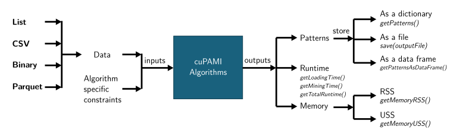
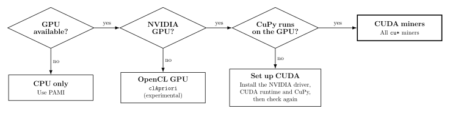
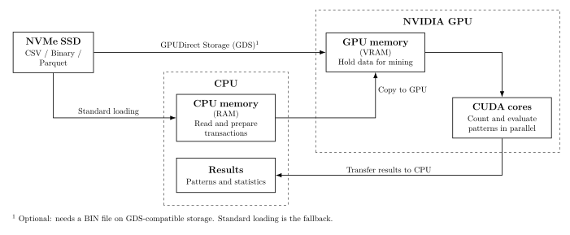

# cuPAMI

[](https://pypi.org/project/cupami/)
[](https://pypi.org/project/cupami/)
[](LICENSE)

cuPAMI mines frequent, periodic, fuzzy, spatial, and coverage patterns on the GPU.
It is the CUDA companion to [PAMI](https://github.com/UdayLab/PAMI), the main
pattern-mining library, and targets NVIDIA GPUs. Experimental `clApriori`
also provides an OpenCL backend for AMD-compatible and other OpenCL GPUs.
This repository is under development.

## Install

```bash
pip install cupami
pip install cupy-cuda12x   # choose the CuPy build that matches your CUDA version
```

CUDA mining requires an NVIDIA GPU and CuPy. Optional features:

| Feature | Package | Extra |
|---|---|---|
| Parquet files | `pyarrow` | `cupami[parquet]` |
| OpenCL backend (`clApriori`) | `pyopencl` | `cupami[opencl]` |
| GPUDirect Storage | RAPIDS `kvikio` | |

## Quick start

```python
import cupami as cuPAMI

data = cuPAMI.BinaryTransactionalDatabase(
    transactions=10000,
    items=50,
    avg_length=6,
).create()

miner = cuPAMI.cuApriori(data, minSup=0.01)
miner.mine()
patterns = miner.getPatterns()
```

`avg_length=6` targets an average of six unique items per transaction; individual
lengths vary. This generates 10000 transactions and finds patterns appearing in at least
1% of them. Saving a dataset is optional.

Replace `cuApriori` with `cuEclat` or `cuFPGrowth` to use another algorithm.
See [quickstart.ipynb](quickstart.ipynb) for a runnable example of all three.
For AMD-compatible OpenCL GPUs, see [clApriori](docs/algorithms/clApriori.md).
AMD performance is not yet validated.

## Inputs and outputs

Every miner takes data and its parameters, and reports patterns, runtime, and memory
through the same methods.



*Figure 1. Inputs and outputs shared by every cuPAMI miner.*

```python
print("Loading:", miner.getLoadingTime())
print("Mining:", miner.getMiningTime())
print("Total:", miner.getTotalRuntime())
```

All times are seconds. Loading covers constructor input parsing and transfer;
mining covers GPU preparation and search, including initialization on first use.
Total is loading plus the latest mining time. Generation, idle time, and saving
are excluded. `getRuntime()` remains the mining-time shorthand.

## Algorithms

Each algorithm name links to its guide with inputs, parameters, and examples.

| Data | Algorithm | Parameters | Notebook |
|---|---|---|---|
| Binary transactional coverage | [`cuCMine`](docs/algorithms/cuCMine.md) | `minRF`, `minCS`, `maxOR` | [Notebook](notebooks/coveragePattern/cuCMine.ipynb) |
| Binary transactional | [`cuApriori`](docs/algorithms/cuApriori.md) | `minSup` | [Notebook](notebooks/frequentPattern/cuApriori.ipynb) [](https://colab.research.google.com/github/udayRage/cuPAMI/blob/main/notebooks/frequentPattern/cuApriori.ipynb) |
| Binary transactional | [`cuEclat`](docs/algorithms/cuEclat.md) | `minSup` | [Notebook](notebooks/frequentPattern/cuEclat.ipynb) [](https://colab.research.google.com/github/udayRage/cuPAMI/blob/main/notebooks/frequentPattern/cuEclat.ipynb) |
| Binary transactional | [`cuFPGrowth`](docs/algorithms/cuFPGrowth.md) | `minSup` | [Notebook](notebooks/frequentPattern/cuFPGrowth.ipynb) [](https://colab.research.google.com/github/udayRage/cuPAMI/blob/main/notebooks/frequentPattern/cuFPGrowth.ipynb) |
| Binary transactional (OpenCL, experimental) | [`clApriori`](docs/algorithms/clApriori.md) | `minSup` | [Notebook](notebooks/frequentPattern/clApriori.ipynb) [](https://colab.research.google.com/github/udayRage/cuPAMI/blob/main/notebooks/frequentPattern/clApriori.ipynb) |
| Temporal | [`cuPFApriori`](docs/algorithms/cuPFApriori.md) | `minSup`, `maxPer` | [Notebook](notebooks/periodicFrequentPattern/cuPFApriori.ipynb) [](https://colab.research.google.com/github/udayRage/cuPAMI/blob/main/notebooks/periodicFrequentPattern/cuPFApriori.ipynb) |
| Temporal | [`cuPFEclat`](docs/algorithms/cuPFEclat.md) | `minSup`, `maxPer` | [Notebook](notebooks/periodicFrequentPattern/cuPFEclat.ipynb) [](https://colab.research.google.com/github/udayRage/cuPAMI/blob/main/notebooks/periodicFrequentPattern/cuPFEclat.ipynb) |
| Temporal | [`cuPFGrowth`](docs/algorithms/cuPFGrowth.md) | `minSup`, `maxPer` | [Notebook](notebooks/periodicFrequentPattern/cuPFGrowth.ipynb) [](https://colab.research.google.com/github/udayRage/cuPAMI/blob/main/notebooks/periodicFrequentPattern/cuPFGrowth.ipynb) |
| Temporal | [`gPFMiner`](docs/algorithms/gPFMiner.md) | `minSup`, `maxPer` | [Notebook](notebooks/periodicFrequentPattern/gPFMiner.ipynb) [](https://colab.research.google.com/github/udayRage/cuPAMI/blob/main/notebooks/periodicFrequentPattern/gPFMiner.ipynb) |
| Partial-periodic temporal | [`cuPPPApriori`](docs/algorithms/cuPPPApriori.md) | `minPS`, `period` | [Notebook](notebooks/partialPeriodicPattern/cuPPPApriori.ipynb) [](https://colab.research.google.com/github/udayRage/cuPAMI/blob/main/notebooks/partialPeriodicPattern/cuPPPApriori.ipynb) |
| Partial-periodic temporal | [`cuPPPEclat`](docs/algorithms/cuPPPEclat.md) | `minPS`, `period` | [Notebook](notebooks/partialPeriodicPattern/cuPPPEclat.ipynb) [](https://colab.research.google.com/github/udayRage/cuPAMI/blob/main/notebooks/partialPeriodicPattern/cuPPPEclat.ipynb) |
| Fuzzy CSV | [`cuFFIMiner`](docs/algorithms/cuFFIMiner.md) | `minSup` | [Notebook](notebooks/fuzzyFrequentPattern/cuFFIMiner.ipynb) [](https://colab.research.google.com/github/udayRage/cuPAMI/blob/main/notebooks/fuzzyFrequentPattern/cuFFIMiner.ipynb) |
| Fuzzy CSV | [`cuMFFIMiner`](docs/algorithms/cuMFFIMiner.md) | `minSup` | [Notebook](notebooks/fuzzyFrequentPattern/cuMFFIMiner.ipynb) [](https://colab.research.google.com/github/udayRage/cuPAMI/blob/main/notebooks/fuzzyFrequentPattern/cuMFFIMiner.ipynb) |
| Fuzzy CSV | [`cuMultiFuzzyBaseline`](docs/algorithms/cuMultiFuzzyBaseline.md) | `minSup` | [Notebook](notebooks/fuzzyFrequentPattern/cuMultiFuzzyBaseline.ipynb) [](https://colab.research.google.com/github/udayRage/cuPAMI/blob/main/notebooks/fuzzyFrequentPattern/cuMultiFuzzyBaseline.ipynb) |
| Spatial CSV + neighbour CSV | [`cuSpatialEclat`](docs/algorithms/cuSpatialEclat.md) | `minSup` | [Notebook](notebooks/georeferencedFrequentPattern/cuSpatialEclat.ipynb) [](https://colab.research.google.com/github/udayRage/cuPAMI/blob/main/notebooks/georeferencedFrequentPattern/cuSpatialEclat.ipynb) |

Transactional results contain each pattern's support count. Temporal results
contain `(support, periodicity)`.

## Choosing a backend



*Figure 2. Choosing a backend.*

The CUDA check passes when CuPy can access the GPU and run a CUDA operation.
Only `clApriori` supports OpenCL.

## GPU loading and mining



*Figure 3. CUDA data loading and GPU mining.*

See [loading formats and GDS details](docs/transaction-formats.md#gpu-loading-and-mining).

## Temporal data

```python
import cupami as cuPAMI

data = cuPAMI.TemporalDatabase(
    transactions=10000,
    items=50,
    avg_length=6,
).create()

miner = cuPAMI.cuPFEclat(data, minSup=0.02, maxPer=100)
miner.mine()
patterns = miner.getPatterns()
```

`maxPer=100` allows a maximum gap of 100 timestamp units, including the start
and end gaps. Temporal input rows have a timestamp followed by their items.
Use `repeatAllowed=True` to allow repeated timestamps and `missingAllowed=True`
to allow gaps. Set `mergeTimestamps=True` to combine repeated timestamps.
See the [cuPFEclat notebook](notebooks/periodicFrequentPattern/cuPFEclat.ipynb).

## Fuzzy data (CSV)

```python
import cupami as cuPAMI

file = "https://u-aizu.ac.jp/~udayrage/datasets/fuzzyDatabases/Fuzzy_T10I4D100K.csv"
miner = cuPAMI.cuFFIMiner(file, minSup=0.005)
miner.mine()
patterns = miner.getPatterns()
```

A local fuzzy CSV filename works too. Rows contain `items:memberships`.
The miner keeps the strongest fuzzy region per base item and returns
floating-point support. Use `cuMFFIMiner` to keep all frequent regions,
with at most one region per base item in a pattern. It uses shared base-item
traversal on a local fuzzy CSV/text file; `cuMultiFuzzyBaseline` uses flat traversal:

```python
miner = cuPAMI.cuMFFIMiner("fuzzy.csv", minSup=0.005)
miner.mine()
patterns = miner.getPatterns()
```

See [fuzzy input details](docs/fuzzy-data.md).

## Spatial data

```python
miner = cuPAMI.cuSpatialEclat("transactions.csv", "neighbours.csv", minSup=0.01)
miner.mine()
print("Patterns:", len(miner.getPatterns()))
```

Like PAMI's `SpatialECLAT`, the miner takes item-only transactions and a
neighbour file. CSV input only; support counting runs on the GPU. See
[spatial input details](docs/spatial-data.md) and the notebook example.

## Working with files

Transactional and temporal miners accept CSV, BIN, and Parquet files.
Use a file containing the matching type of data:

```python
miner = cuPAMI.cuEclat("transactions.bin", minSup=0.01)
miner.mine()
```

To save generated data, keep the generator:

```python
generator = cuPAMI.BinaryTransactionalDatabase(
    transactions=10000,
    items=50,
    avg_length=6,
)
data = generator.create()
generator.save("transactions.csv")
generator.save("transactions.bin")
generator.save("transactions.parquet")
```

After generation, both generators expose runtime in seconds and process memory
in bytes:

```python
print(generator.getRuntime())
print(generator.getMemoryRSS())
print(generator.getMemoryUSS())
```

These measure the latest `create()` or direct-to-file generation. RSS/USS are
snapshots after generation, not peak or generator-only memory; memory reporting
uses `psutil` (unavailable values return 0). `save()` does not reset them.

Parquet export and temporal Parquet input require PyArrow.
`TemporalDatabase` also supports all three export formats. See [data formats and GPU loading](docs/transaction-formats.md)
for input details and optional GDS support.

## Binary and quantitative transaction generation

`BinaryTransactionalDatabase` generates item-presence baskets.
`TransactionalDatabase` remains available with the same binary behavior.
`QuantitativeTransactionalDatabase` generates a separate item-to-quantity mapping
for each transaction:

```python
binary = cuPAMI.BinaryTransactionalDatabase(10000, 50, avg_length=6, seed=42)
transactions = binary.create()  # e.g. [1, 5, 9]

quantitative = cuPAMI.QuantitativeTransactionalDatabase(
    10000, 50, avg_length=6, seed=42, min_quantity=1, max_quantity=10,
)
quantities = quantitative.create()  # e.g. {1: 3, 5: 7, 9: 2}
quantitative.save("quantities.csv")
quantitative.save("quantities.bin")
quantitative.save("quantities.parquet")
```

Quantities are raw amounts. Fuzzy miners require transformed memberships.
See [formats and conversion](docs/transaction-formats.md).

## Convert a dataset

```python
cuPAMI.convertFile("transactions.csv", "transactions.bin")
cuPAMI.convertFile("transactions.bin", "transactions.parquet")
cuPAMI.convertFile("transactions.parquet", "transactions.tsv")
cuPAMI.convertFile("quantities.csv", "quantities.bin", dataType="quantitative")

cuPAMI.convertFile("temporal.csv", "temporal.bin", dataType="temporal")
```

The converter works in both directions between CSV, TSV, BIN, and Parquet.
It also has a command-line interface:

```bash
python -m cupami.extras.datasetConverter transactions.csv transactions.bin
python -m cupami.extras.datasetConverter transactions.bin transactions.parquet
python -m cupami.extras.datasetConverter quantities.parquet quantities.csv --data-type quantitative
```

## GPUDirect Storage (GDS)

On a system configured for GDS, install compatible CuPy and KvikIO packages
and keep the BIN dataset on supported storage. Then enable GDS:

```python
miner = cuPAMI.cuApriori("transactions.bin", minSup=0.01, use_gds=True)
miner.mine()
```

This also works with `cuEclat` and `cuFPGrowth`. The default `use_gds="auto"`
falls back when GDS is unavailable. Temporal file loading currently uses the CPU.
See [GDS setup and verification](docs/transaction-formats.md#optional-gds-input).

## References

See the [per-file CUDA references and implementation mapping](docs/algorithm-references.md)
for GPU papers, pinned PAMI source links, and local adaptations. Each miner also
includes its CUDA references in its module docstring.

### Algorithm sources

| Implementation | Reference |
|---|---|
| `cuApriori` | GPApriori, CLUSTER 2011, Section IV; PAMI cuApriori/cuAprioriBit; Apriori [1] |
| `cuPFApriori`, `cuPFEclat`, `cuPFGrowth` | PAMI gPFMinerBit; related gPF-Miner, IEEE Big Data 2022; periodic model [5] |
| `gPFMiner` (gPF-Miner, public bitset variant) | Tarun et al., IEEE Big Data 2022; [paper](https://doi.org/10.1109/BigData55660.2022.10020216); [implementation notes](docs/algorithms/gPFMiner.md) |
| `cuEclat` | PAMI cuEclatBit; gpuDCI GPU intersections, PDP 2012; Eclat [2, 3] |
| `cuFPGrowth` | Arour and Belkahla, CIT 2014, Section 5.3; FP-growth [4] |
| `cuPPPApriori`, `cuPPPEclat` | PAMI gPPMiner GPU scan; PPP_ECLAT API and consecutive-gap semantics |
| Periodicity definition and pruning | Kiran, Kitsuregawa and Reddy, JSS 2016 [5] |
| `cuFFIMiner` fuzzy support and region selection | Lin, Li, Fournier-Viger and Hong, JIFS 2015 [6] |
| `cuMFFIMiner` multiple-region support and joins | Lin et al., IJFS 2017 (online 2016) [7] |
| `cuSpatialEclat` spatial constraints and neighbour pruning | Kiran et al., SIGSPATIAL 2020 [8]; Eclat [3] |

These implementations adapt the referenced algorithms for CUDA. The temporal
miners add maximum-gap checks, including the start and end gaps.

1. Rakesh Agrawal and Ramakrishnan Srikant. **Fast Algorithms for Mining
   Association Rules.** VLDB, 1994, pp. 487–499, Section 2.1.
   [Paper](https://www.vldb.org/conf/1994/P487.PDF).
2. Mohammed J. Zaki, Srinivasan Parthasarathy, Mitsunori Ogihara and Wei Li.
   **New Algorithms for Fast Discovery of Association Rules.** KDD, 1997,
   pp. 283–286. [Paper](https://www.cs.rpi.edu/~zaki/PaperDir/KDD97.pdf).
3. Mohammed J. Zaki. **Scalable Algorithms for Association Mining.** IEEE TKDE,
   12(3), 2000, pp. 372–390. DOI: 10.1109/69.846291.
   [Paper](https://www.cs.rpi.edu/~zaki/PaperDir/TKDE00.pdf).
4. Jiawei Han, Jian Pei and Yiwen Yin. **Mining Frequent Patterns without
   Candidate Generation.** SIGMOD, 2000, pp. 1–12.
   DOI: 10.1145/342009.335372. Algorithms 1–2 and Lemma 3.2.
   [Paper](https://cse.hkust.edu.hk/~raywong/comp5331/References/MiningFrequentPatternsWithoutCandidateGeneration.pdf).
5. R. Uday Kiran, Masaru Kitsuregawa and P. Krishna Reddy.
   **Efficient Discovery of Periodic-Frequent Patterns in Very Large Databases.**
   Journal of Systems and Software, 112, 2016, pp. 110–121.
   Section 1 and Example 1.
   [Paper](https://www.tkl.iis.u-tokyo.ac.jp/new/uploads/publication_file/file/744/5-8-2015_final.pdf).
6. Jerry Chun-Wei Lin, Ting Li, Philippe Fournier-Viger and Tzung-Pei Hong.
   **A fast Algorithm for mining fuzzy frequent itemsets.** Journal of
   Intelligent & Fuzzy Systems, 29(6), 2015, pp. 2373–2379.
   DOI: 10.3233/IFS-151936. Definitions 4–5, Strategy 1 and Algorithm 1.
   [Paper](https://www.philippe-fournier-viger.com/spmf/ffiminer.pdf).
7. Jerry Chun-Wei Lin, Ting Li, Philippe Fournier-Viger, Tzung-Pei Hong,
   Jimmy Ming-Tai Wu and Justin Zhan. **Efficient Mining of Multiple Fuzzy
   Frequent Itemsets.** International Journal of Fuzzy Systems, 19(4), 2017,
   pp. 1032–1040; published online in 2016. DOI: 10.1007/s40815-016-0246-1.
   [Paper](https://www.philippe-fournier-viger.com/spmf/mffiminer.pdf).
8. R. Uday Kiran, Sourabh Shrivastava, Philippe Fournier-Viger, Koji Zettsu,
   Masashi Toyoda and Masaru Kitsuregawa. **Discovering Frequent Spatial
   Patterns in Very Large Spatiotemporal Databases.** SIGSPATIAL 2020,
   pp. 445–448. DOI: 10.1145/3397536.3422206.
   [Paper](https://doi.org/10.1145/3397536.3422206).

### Code and GPU I/O credits

- **CUDA bitsets and cuDF loading:** adapted from
  [udayRage/cuda_pami](https://github.com/udayRage/cuda_pami),
  `src/algorithms/frequent/fpminer-bitset.py`, revision
  `2ed352a92190bf45455f61925f76b2363b7a7590`, GPL-3.0.
  [Source](https://github.com/udayRage/cuda_pami/blob/2ed352a92190bf45455f61925f76b2363b7a7590/src/algorithms/frequent/fpminer-bitset.py).
- **GDS:** NVIDIA [GPUDirect Storage](https://docs.nvidia.com/gpudirect-storage/overview-guide/index.html)
  and [cuFile API](https://docs.nvidia.com/gpudirect-storage/api-reference-guide/index.html),
  accessed through RAPIDS [KvikIO](https://github.com/rapidsai/kvikio).
  See the [KvikIO API](https://docs.rapids.ai/api/kvikio/stable/api/)
  and [runtime settings](https://docs.rapids.ai/api/kvikio/stable/runtime_settings/).
- **BIN layout, converter, and temporal CUDA kernels:** implemented in this repository.
- **Fuzzy mining:** strongest-region selection and vertical search follow
  [PAMI FFIMiner](https://github.com/UdayLab/PAMI/blob/48d0c25fb5f1e4ff32e797fa00873033921f1aa7/PAMI/fuzzyFrequentPattern/basic/FFIMiner.py).
  The GPU minimum/reduction approach is adapted from
  [PAMI cuFFIMiner](https://github.com/UdayLab/PAMI/blob/48d0c25fb5f1e4ff32e797fa00873033921f1aa7/PAMI/fuzzyFrequentPattern/cuda/cuFFIMiner.py),
  GPL-3.0, Copyright (C) 2021 Rage Uday Kiran; PAMI credits the CUDA code to
  Mithun Thangaraj. cuPAMI uses float64 memberships and batched depth-first search.
- **Multiple fuzzy regions:** `cuMFFIMiner` uses shared base-item traversal and
  `cuMultiFuzzyBaseline` provides flat traversal for “cuMFFP-Miner: GPU-Accelerated
  Multiple Fuzzy Frequent Pattern Mining via Shared Base-Item Traversal” by
  Mithun Thangaraj and Rage Uday Kiran, The University of Aizu, Japan.
- **Spatial neighbour pruning:** based on
  [PAMI SpatialECLAT](https://github.com/UdayLab/PAMI/blob/d6d05d9f9134f6039eede0c69b463fc1c2031262/PAMI/georeferencedFrequentPattern/basic/SpatialECLAT.py),
  written by B. Sai Chitra under Professor Rage Uday Kiran, GPL-3.0,
  Copyright (C) 2021 Rage Uday Kiran. cuPAMI uses the shared CUDA Eclat
  bitsets for support counting and CPU neighbour checks for candidate pruning.
